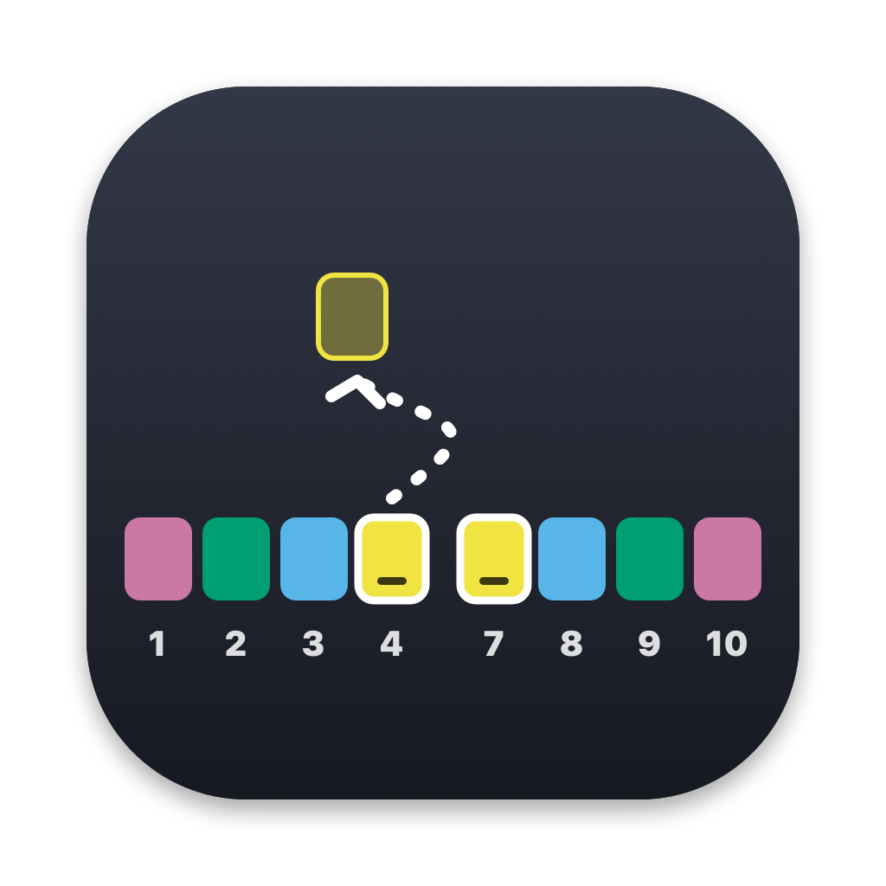
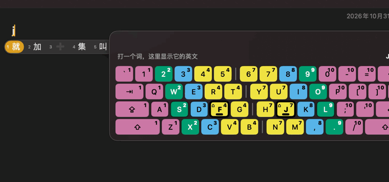

<p align="center">
  
</p>

<h1 align="center">FingerPath</h1>

<p align="center">
  <b>An on-screen keyboard that sits right next to your IME candidate bar.</b><br>
  Keep your eyes on the screen, not on your hands.<br>
  <b>贴着输入法候选条的屏幕键盘：眼睛看屏幕，不看手。</b>
</p>

<p align="center">
  <a href="#english">English</a> · <a href="#中文">中文</a>
</p>

<p align="center">
  
</p>

---

## English

### Why

Learning to touch-type is hard when you keep glancing down at the keyboard. Typing Chinese makes it worse: your eyes jump between the keyboard, the text field, and the IME candidate bar.

FingerPath puts a small keyboard **right next to the candidate bar**, so the text you type, the candidates you pick, and the keys you press are all in one place.

### Features

- **Follows your input.** The keyboard docks beside the system IME candidate bar (above it when the bar is above your text, below it otherwise). It doesn't jitter while you type.
- **Finger numbers 1–10.** Every key shows which finger should press it, from the left pinky (1) to the right pinky (10).
- **Color-blind friendly colors.** Each finger has its own color (Okabe-Ito palette), and left / right hands are separated by a divider.
- **F / J anchors.** The two home keys have a thick frame, a bold bump, and a ⌂ mark, so you can always find your way home.
- **Live feedback.** The key you press lights up (black with white text, no color needed).
- **English as you type** (macOS 26+). The last word you typed and the whole sentence are translated into English, offline, using the macOS built-in translation. Great for English learners.
- **Gets out of the way.** Fades out after 3 seconds without typing; the mouse passes right through it.
- **Training wheels you can remove.** Hint levels: full → hide letters (colors and numbers only) → show only when you pause.
- **Your weak keys.** Counts keys you delete right after typing (key names and counts only) and shows your most-missed keys in the menu.

### Install

**Download** (easiest):

1. Go to [**Releases**](https://github.com/mulikouc-collab/FingerPath/releases/latest) and download `FingerPath-x.y.z-macOS.zip` (works on both Apple silicon and Intel Macs).
2. Unzip it and drag **FingerPath.app** into your **Applications** folder.
3. Open it. Because FingerPath isn't signed with a paid Apple Developer ID yet, macOS will say it can't verify the developer. Click **Done**, then go to **System Settings → Privacy & Security**, scroll down and click **Open Anyway**.
   (Or run `xattr -dr com.apple.quarantine /Applications/FingerPath.app` in Terminal.)

**Build from source** (requires the Xcode Command Line Tools):

```bash
git clone https://github.com/mulikouc-collab/FingerPath.git
cd FingerPath
zsh scripts/install_and_run.sh
```

Tip: set `SIGN_IDENTITY` to a code-signing identity of yours (e.g. `SIGN_IDENTITY="My Cert" zsh scripts/install_and_run.sh`) so macOS keeps the Accessibility permission across rebuilds.

Then open **System Settings → Privacy & Security → Accessibility** and turn on **FingerPath**.

FingerPath lives in the menu bar (keyboard icon). Use the menu to show / hide the keyboard, choose the position and hint level, and toggle translation.

Requirements: macOS 14 or later. English translation needs macOS 26 or later and the Chinese and English translation languages downloaded in **System Settings → General → Language & Region → Translation Languages**.

### Privacy

- Key presses are used **only** to light up keys on screen. Nothing you type is recorded, saved, or sent anywhere.
- Mistake statistics store **only key names and counts**, locally.
- Translation runs **offline** on your Mac.
- FingerPath reads where your text field and the candidate bar are (via Accessibility and the window list). It does **not** record your screen and does **not** need Screen Recording permission.
- When you type a password, macOS enables Secure Input and FingerPath receives no key presses at all.

### How it works

- Global key monitoring (Accessibility permission) lights up keys by key code, so it works with any input method.
- The focused text field's position comes from the Accessibility API.
- The system IME candidate bar is a small floating window owned by the app you're typing in; FingerPath reads its frame from the window list and docks beside it.

### Roadmap

- [x] Demo GIF
- [x] Prebuilt releases (Apple silicon + Intel)
- [ ] Notarized releases (needs a paid Apple Developer ID)
- [ ] Windows version (if people like the idea)
- [ ] More keyboard layouts

### License

[GPL-3.0](LICENSE)

---

## 中文

### 为什么做这个

学盲打最难的是**忍住不低头看键盘**。打中文更麻烦：眼睛要在键盘、输入框、输入法候选条之间来回跳。

FingerPath 把一个小键盘**贴在输入法候选条旁边**，你打的字、要选的候选词、要按的键都在同一块地方。

### 功能

- **跟着输入框走**：键盘紧贴系统输入法的候选条（候选条在文字上方，键盘就在它上面；否则在下面），打字时不乱晃
- **手指编号 1～10**：每个键都标出该用几号手指，左手小指是 1，右手小指是 10
- **色弱友好的配色**：每根手指一种颜色（Okabe-Ito 色板），左右手之间有分隔线
- **F / J 定位键**：最粗的边框、粗凸点、⌂ 标记，手指随时找得到「家」
- **实时反馈**：按下的键变成黑底白字，不靠颜色也能看清
- **边打字边看英文**（macOS 26 及以上）：刚打的词和整句自动翻译成英文，用系统自带的离线翻译，适合学英语
- **不碍事**：停止打字 3 秒后慢慢淡出；鼠标可以直接穿过它
- **可以逐步「断奶」**：提示等级从「完整显示」→「隐藏字母（只留颜色和编号）」→「只在停顿时显示」
- **常错键**：统计按完马上删掉的键（只记键名和次数），在菜单里显示你最容易打错的键

### 安装

**直接下载**（最简单）：

1. 打开 [**Releases 发布页**](https://github.com/mulikouc-collab/FingerPath/releases/latest)，下载 `FingerPath-x.y.z-macOS.zip`（Apple 芯片和 Intel 芯片的 Mac 都能用）
2. 解压，把 **FingerPath.app** 拖进「**应用程序**」文件夹
3. 打开它。因为 FingerPath 还没有用付费的苹果开发者证书签名，系统会提示「无法验证开发者」。点「**完成**」，然后到 **系统设置 → 隐私与安全性**，往下拉，点「**仍要打开**」
   （或者在终端运行 `xattr -dr com.apple.quarantine /Applications/FingerPath.app`）

**从源码编译**（需要 Xcode 命令行工具）：

```bash
git clone https://github.com/mulikouc-collab/FingerPath.git
cd FingerPath
zsh scripts/install_and_run.sh
```

小提示：设置 `SIGN_IDENTITY` 为你自己的签名证书（例如 `SIGN_IDENTITY="我的证书" zsh scripts/install_and_run.sh`），重新编译后就不用重新授权辅助功能。

然后打开 **系统设置 → 隐私与安全性 → 辅助功能**，打开 **FingerPath**。

FingerPath 在菜单栏（键盘图标）。菜单里可以显示 / 隐藏键盘、选位置和提示等级、开关英文翻译。

系统要求：macOS 14 及以上。英文翻译需要 macOS 26 及以上，并在 **系统设置 → 通用 → 语言与地区 → 翻译语言** 里下载中文和英语。

### 隐私

- 按键**只用来**点亮屏幕上的键，你打的内容**不记录、不保存、不上传**
- 常错键统计**只记键名和次数**，只存在本机
- 翻译**离线**完成
- FingerPath 只读取输入框和候选条的**位置**（通过辅助功能和窗口列表），**不录屏**，也**不需要**屏幕录制权限
- 输入密码时，macOS 会开启「安全输入」，FingerPath 收不到任何按键

### 原理

- 全局按键监听（辅助功能权限），按键码点亮，任何输入法都适用
- 输入框位置来自辅助功能接口
- 系统输入法的候选条是你正在打字的软件名下的一个小浮动窗口，FingerPath 从窗口列表读出它的位置，贴在旁边

### 计划

- [x] 演示动图
- [x] 打包好的安装包（Apple 芯片 + Intel）
- [ ] 经苹果公证的安装包（需要付费开发者账号）
- [ ] Windows 版（如果大家喜欢）
- [ ] 更多键盘布局

### 许可证

[GPL-3.0](LICENSE)
